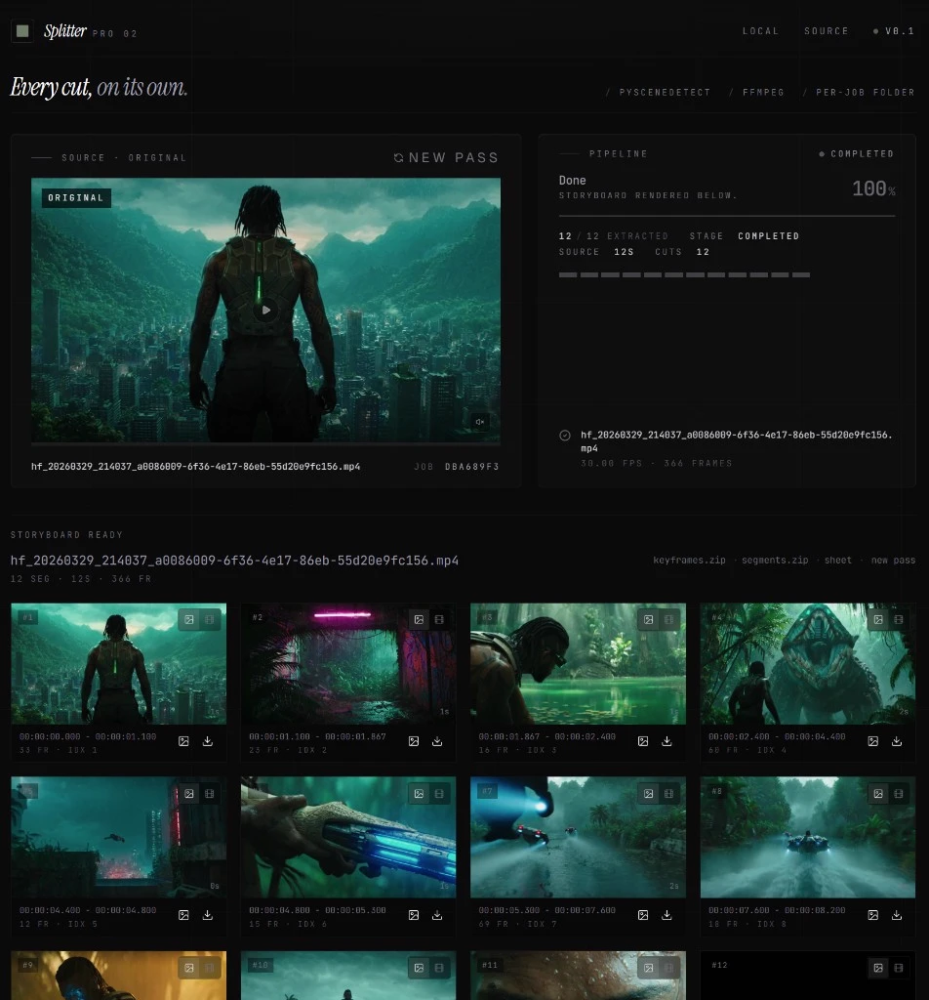
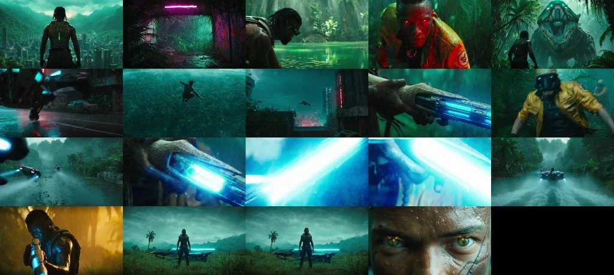

# Splitter Pro 2



**Result — contact sheet (exported `contact-sheet.jpg` / storyboard stills):** one frame per detected scene in a single grid, produced after a job finishes.



Splitter Pro 2 is a local-first video review app that splits a video by detected scene cuts, an exact number of equal slices, or a fixed time step. It renders a storyboard with one stable midpoint image plus a previewable clip for every segment.

The video page offers three sampling modes before upload:

- **Scene cuts** — PySceneDetect finds visual edit points automatically.
- **Equal count** — creates an exact total (for example 10) across the complete video and extracts the midpoint image from every equal slice.
- **Time step** — creates one slice and midpoint image every selected number of seconds, with a shorter final slice when needed.

## Storyboard grids

The separate **Storyboard grids** tab builds a grid from your own images. Drop PNG,
JPG, or WebP files into the image bank, choose a 2×2, 3×3, 4×4, or 5×5 layout,
then drag shots into positions. Dragging between filled positions swaps them;
selecting a bank image and clicking a position also works. **Auto fill** fills
empty positions in bank order. Images remain available in the bank.

Every board and export is **16:9 landscape**. **Grid**, **Hero**, and **Strip** are
adapted from PinDeck. A hero can span 2×2 cells (or more) in any corner.
**Side hero** places a wider image on the left and two to five upright frames
side by side on the right, with the wide frame twice the area of each small one.
The hero can be on either side, with equal, 1.5×, 2×, or 3× widths.
**Portrait panels** offers equal upright frames for portrait inputs, spanning
the whole landscape sheet with no outer padding. Fill and crop is the default.
**Mixed** combines two 9:16 portraits, four square details, and four wide frames
in one edge-to-edge 16:9 sheet.
Incoming images are never split.
**Adjust framing** switches from rearranging positions to
editing a placed image: choose Fit or Fill for that image, then drag inside a
filled frame or use Left/Center/Right and Top/Middle/Bottom alignment buttons.
Scale the selected image in 25% increments from 25% to 400%, or reset to 100%.
Crop settings travel with the image when you rearrange it and apply to exports.
PNG exports are 1920×1080 or 3840×2160, with the chosen gap and either whole-image
fitting or cropped filling. Landscape and portrait source images are accepted
in every layout. Empty positions export with
the board's dark background. The board stays intact when switching app tabs;
export before closing or reloading the page. Arrangement and export run in the
browser. The bank holds up to 100 images, 100 MB each.

Each shot has **Remove background**, which uploads that shot to the app server
and adds a new opaque PNG to the bank without replacing the original or its
board position. Choose any grayscale background using the black-to-white slider,
or the Black / 50% gray / White presets. **Subject to keep** tells SAM 3 what to
preserve (include accessories such as a backpack when needed). Production jobs
run through the dedicated Splitter Trigger project and the private app-vm GPU
worker. Each inference process exits to release VRAM. SAM's predicted mask is
used without added blur, feathering, erosion, or stretching. Inputs are limited
to 32 megapixels. Original and processed job files remain in app-owned job
storage so retries and output download can recover from an interrupted request.
Local development without Trigger uses BiRefNet General Lite on the CPU;
production disables that fallback to protect Hostinger's RAM.

Video scene detection and exports use the separate `splitter-process-video`
Trigger task when configured. Image-grid splitting remains CPU-only. See
[`docs/processing-orchestration.md`](docs/processing-orchestration.md).

**Split grids** is the separate tool for cutting existing grid images into panels.

## YouTube import

In **Source**, choose **YouTube link**, select a split mode, then **Download and split**.
The API equivalent is `POST /api/jobs/youtube` with JSON:

```json
{"url":"https://www.youtube.com/watch?v=VIDEO_ID","split_mode":"scenes","use_cookies":false,"clip_start_seconds":90,"clip_end_seconds":240}
```

Optional `clip_start_seconds` and `clip_end_seconds` limit import to that range (seconds from the start of the video). Omit either bound to use the start or end of the video.

The response is HTTP 202 with a normal job ID. Poll `GET /api/jobs/{job_id}` for
download bytes and the downloading / preparing / scene detection / extraction
stages, then use the existing result and asset endpoints. The source preview is
withheld until download and merging complete. Only individual HTTPS YouTube
videos are accepted; playlists, arbitrary URLs, and live streams are excluded.
Imports default to 1080p, 1 GiB, one hour of video, and a 15-minute download
timeout. At most two downloads run per backend process. A busy or failed job
requires an explicit new pass; it is never silently retried. Background jobs
run in the existing process: keep the server running until a job finishes.

### Private YouTube cookies

Following Yippr's `YIPPR_YTDLP_COOKIES_FILE` pattern, set
`SPLITTER_YOUTUBE_COOKIES_FILE` to an operator-managed Netscape cookie file,
outside `data/jobs` and the frontend. In Docker, place it at
`/app/data/private/youtube.cookies.txt` in the persistent volume and set that path
in the untracked server `.env`. Keep access restricted to the service account.
Then select **Use the server’s private YouTube cookies** for the import.

Use [yt-dlp's official YouTube cookie-export instructions](https://github.com/yt-dlp/yt-dlp/wiki/Extractors#exporting-youtube-cookies)
for your own authorized YouTube session. Do not paste cookie contents into chat,
commit them, or export an entire browser profile. Splitter copies only unexpired
YouTube-domain cookies into a temporary private directory for the job and removes
that copy afterward. There is no browser-cookie extraction or cookie upload API.
The original cookie file is never modified. Errors do not return raw downloader
output. Cookies do not guarantee access: YouTube can still require a fresh
session or rate-limit the server; the UI reports that failure and accepts a local
video file instead.

The backend installs `yt-dlp[default]` (including EJS); the container includes
Deno. Local development needs Deno or Node 22+ on PATH. To update the downloader,
run `uv lock --upgrade-package yt-dlp --upgrade-package yt-dlp-ejs` in `backend`,
then `uv sync --frozen`, run the tests and rebuild the container.

## Stack

- Backend: FastAPI, PySceneDetect, ffmpeg
- Frontend: React 19, Vite 8, Tailwind CSS v4, shadcn-style primitives
- Tooling: `uv` for Python, `bun` for frontend

## Scene detection (frame-based)

Cuts are detected and stored on **frame indices**; durations in the UI are derived from `fps` and those frames. PySceneDetect `AdaptiveDetector` is the default. Tune without code changes using env vars (prefix `SPLITTER_`, see `backend/src/backend/config.py`):

| Variable | Role |
|----------|------|
| `SPLITTER_ADAPTIVE_THRESHOLD` | Lower → more / finer cuts (more sensitive). |
| `SPLITTER_MIN_SCENE_LEN_FRAMES` | Minimum gap (frames) before another cut can register; lower allows quicker successive shots. |
| `SPLITTER_MIN_CONTENT_VAL` | Lower → easier to pass as a new scene. |
| `SPLITTER_ADAPTIVE_WINDOW_WIDTH` | Smaller → less smoothing, can catch very short shot changes. |
| `SPLITTER_MERGE_SHORT_SCENE_FRAMES` | Only merge runs shorter than this (frames) to drop spurious double-cuts; `0` disables. |

For very dense edits (montages, many short shots), start by **lowering** `SPLITTER_ADAPTIVE_THRESHOLD` a bit and **lowering** `SPLITTER_MIN_SCENE_LEN_FRAMES` before changing merge, so real short shots are not merged away.

**Contact sheet & “same shot” stills (notes for next time).** The grid is one still **per segment** PySceneDetect returns. A cut is **not** the same as “a new eyeball shot in the script”—it is a **content / motion** boundary. A bright flash, a light flicker, or a fast wipe inside what feels like one take can still register as a new scene, so two adjacent keyframes (e.g. 17 and 18) can look **almost identical** even though the detector saw a big frame-to-frame change in the data. Tuning `SPLITTER_*` nudges how often that happens but does not understand “this still looks the same to a human.”

*Future / smarter (not built yet):* e.g. compare adjacent keyframes (perceptual hash, SSIM, or small embedding) and, when a pair looks suspiciously similar, **prompt the user**—something like “These shots may be the same shot. Keep them as separate segments, or treat them as one?”—then merge or split based on that choice, plus optional rules for short spikes (flash) vs. true edit points. For now, treat duplicate-looking tiles as a known quirk of pure statistical scene detection, not a bug in the contact-sheet export itself.

## Local setup

```powershell
uv venv
.\.venv\Scripts\Activate.ps1
cd backend
uv sync --active
cd ..\frontend
bun install
```

## Run in development

Terminal 1:

```powershell
.\.venv\Scripts\Activate.ps1
cd backend
uv run --active uvicorn backend.app:app --reload
```

Terminal 2:

```powershell
cd frontend
bun run dev
```

The Vite dev server proxies `/api/*` calls to `http://127.0.0.1:8000`.

## Private access gate

Set `SPLITTER_APP_ACCESS_PIN` only in the untracked server `.env` to require a code before the workspace can be used. The PIN remains server-side; a successful attempt issues a 30-day HttpOnly, SameSite=Strict cookie. Protected API and documentation routes reject requests without that cookie, and repeated failed attempts are temporarily throttled. Empty or missing configuration leaves the deployment open.

When using Docker Compose, map the server value into the service environment:

```yaml
SPLITTER_APP_ACCESS_PIN: ${SPLITTER_APP_ACCESS_PIN:-}
```

## Tests

```powershell
.\.venv\Scripts\Activate.ps1
cd backend
uv run --active pytest
cd ..\frontend
bun run test
```

## Docker

```powershell
docker build -t splitter-pro2 .
docker run --rm -p 8000:8000 -e SPLITTER_APP_ACCESS_PIN splitter-pro2
```

Production at `https://splitter.serving.cloud` is this Compose project on the Hostinger VPS. Hostinger Caddy, not Traefik, terminates HTTPS and reverse-proxies that hostname to `splitter-pro2-splitter-pro2-1:8000`. The live route is in `/docker/caddy-hostinger/Caddyfile`. Pushes to `main` deploy it through `.github/workflows/deploy-hostinger.yml`.
